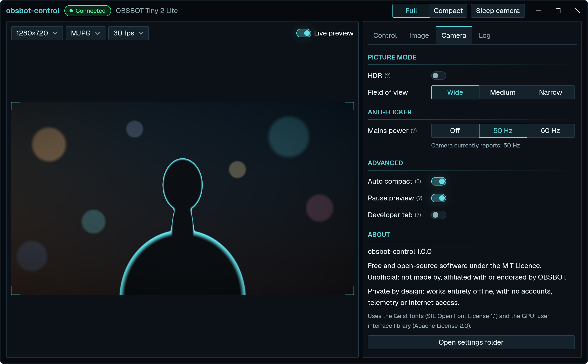
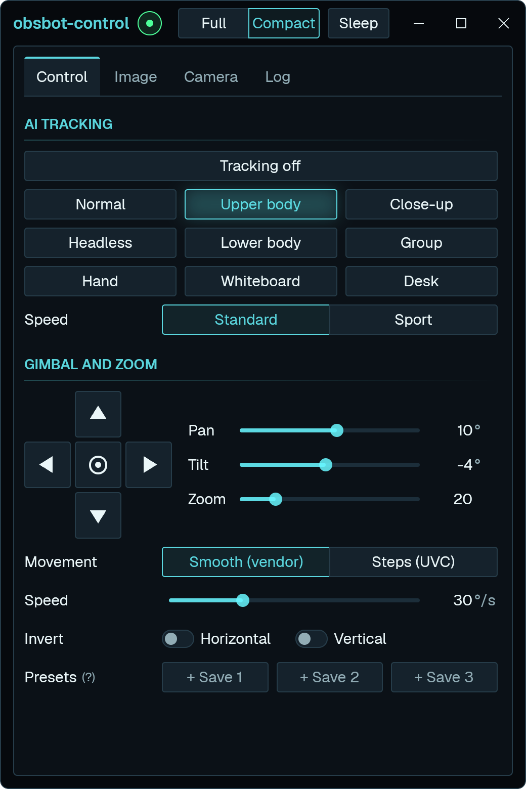
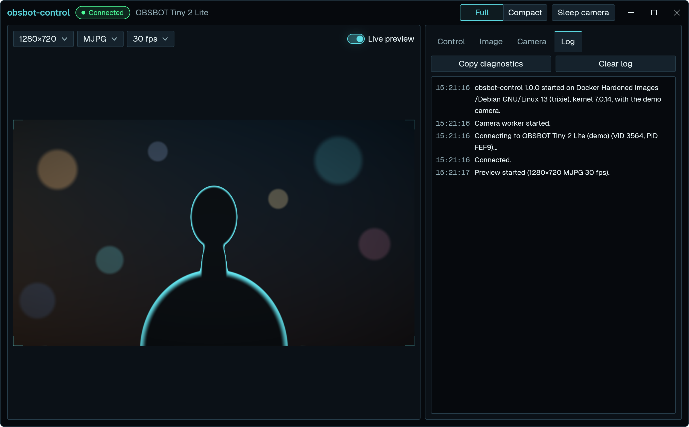

<div align="center">


# obsbot-control

Control your **OBSBOT Tiny 2 Lite** webcam on Windows and Linux,<br>
without OBSBOT Center. One file, fully offline, free and open source.

[**Download**](../../releases/latest) · [Features](#features) · [Run it](#download-and-run) · [Build it](#building-from-source)


</div>

> [!IMPORTANT]
> **Unofficial.** This is an independent community project, not made, endorsed or supported by OBSBOT.
> Report problems here on GitHub, not to OBSBOT support.

## Why

- **One file.** A single `.exe` on Windows or `.AppImage` on Linux. No installer, no admin rights.
- **Private.** No account, telemetry, update checks or internet access.
- **No proprietary code.** It talks to the camera with standard USB video (UVC) controls plus the
  camera's own commands, as documented by other open-source projects.
- **Stays out of the way.** When a call app takes the camera it switches to a compact view with just
  the controls.

## Features

| Area | Controls |
|---|---|
| AI tracking | Off, Normal, Upper body, Close-up, Headless, Lower body, Group, Hand, Whiteboard, Desk; Standard or Sport speed |
| Gimbal | Hold-to-move arrows (smooth or stepped, with invert switches), Centre, pan and tilt sliders, 3 presets |
| Zoom | Zoom slider |
| Picture | Brightness, contrast, saturation, sharpness, hue, gamma, white balance, exposure, gain, backlight and focus, with Auto where supported |
| Camera | HDR, field of view, anti-flicker (50 Hz by default), sleep and wake |
| Other | Live preview with resolution, format and frame rate pickers, compact view, activity log, *Copy diagnostics*, demo mode |

<table>
  <tr>
    <td width="50%"></td>
    <td width="50%"></td>
  </tr>
  <tr>
    <td align="center"><sub>Image tab</sub></td>
    <td align="center"><sub>Camera tab</sub></td>
  </tr>
  <tr>
    <td width="50%" align="center"></td>
    <td width="50%"></td>
  </tr>
  <tr>
    <td align="center"><sub>Compact view</sub></td>
    <td align="center"><sub>Log tab</sub></td>
  </tr>
</table>

<sub>Screenshots use the built-in demo camera (`--demo`), so the video is a drawn scene.</sub>

## Download and run

Get the latest version from [Releases](../../releases/latest) and plug in the camera. The app connects by itself.

### Windows

Download `obsbot-control.exe` and run it. SmartScreen may warn because the exe isn't code-signed:
choose *More info*, then *Run anyway*.

- Needs Windows 10 or 11, 64-bit. Windows "N" editions also need the free *Media Feature Pack*.
- Settings and the log are in `%APPDATA%\obsbot-control\`. Delete that folder to reset.

### Linux

```sh
chmod +x obsbot-control-x86_64.AppImage
./obsbot-control-x86_64.AppImage
```

Works on Wayland and X11 (Fedora, Ubuntu, Arch and others) with any current Vulkan graphics driver.

- **Mentions FUSE?** Install FUSE 3 (`sudo dnf install fuse3` or `sudo apt install fuse3`), or run it
  with `--appimage-extract-and-run`.
- **Permission denied for `/dev/video…`?** Run `sudo usermod -aG video $USER`, then log out and in again.
- Settings and the log are in `~/.config/obsbot-control/`. Delete that folder to reset.

### Tips

- Only one app can use the camera's video at a time. If Teams, Zoom or Discord already has it, the app
  opens in **compact view** and switches back when the call ends. *Full* and *Compact* at the top switch by hand.
- While another window is active the preview pauses, so you can start a call with this app still open.
- Run it with `--demo` to look around without a camera.

## Status

Version 1.0 is a rewrite in Rust that adds Linux. The Windows camera code is a careful port of version 0.3,
which was tested on a real Tiny 2 Lite. The Linux version and the Tiny 2 haven't been tested on real cameras
yet. If something doesn't work, see [docs/TESTING.md](docs/TESTING.md) and
[docs/PROTOCOL.md](docs/PROTOCOL.md), and include *Log → Copy diagnostics* in your report.

## Building from source

Install [Rust](https://rustup.rs/) 1.89 or later (`rust-toolchain.toml` picks the tested version), then the
system libraries:

<details>
<summary>Fedora, Ubuntu and Windows packages</summary>

- **Fedora:** `sudo dnf install gcc clang pkgconf-pkg-config libxkbcommon-devel libxkbcommon-x11-devel wayland-devel vulkan-loader-devel libxcb-devel freetype-devel fontconfig-devel`
- **Ubuntu or Debian:** `sudo apt install build-essential clang pkg-config libxkbcommon-dev libxkbcommon-x11-dev libwayland-dev libvulkan-dev libx11-xcb-dev libxcb1-dev libfreetype-dev libfontconfig-dev`
- **Windows:** Visual Studio 2022 or later (or the Build Tools) with *Desktop development with C++*.

</details>

```sh
cargo build --release
./target/release/obsbot-control --demo     # with the simulated camera
cargo test
packaging/linux/build-appimage.sh          # Linux: makes dist/obsbot-control-x86_64.AppImage
```

The OBSBOT SDK is not needed and is not part of this repository. Built with [GPUI](https://www.gpui.rs/)
and the [Geist](https://vercel.com/font) typeface. Inspired by [obsbot4linux](https://github.com/vampyren/obsbot4linux).

## Disclaimer

"OBSBOT" and "Tiny" are trademarks of their owner, used here only to say which camera this app works with.
The app only changes camera settings and never touches the firmware. If the camera ends up in an odd state,
unplug it and plug it back in. It's provided as is, with no warranty (see the licence).

## Licence

[MIT](LICENSE). Third-party components: [THIRD_PARTY_NOTICES.md](THIRD_PARTY_NOTICES.md).
