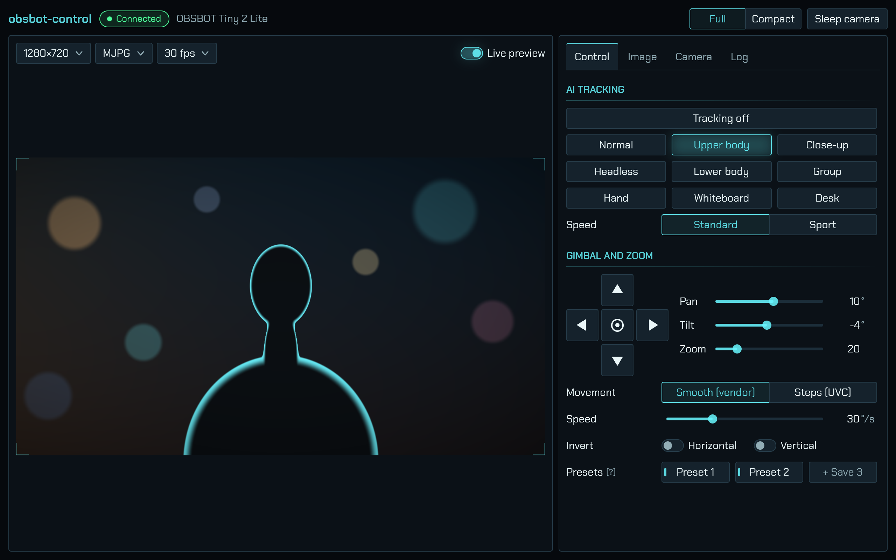
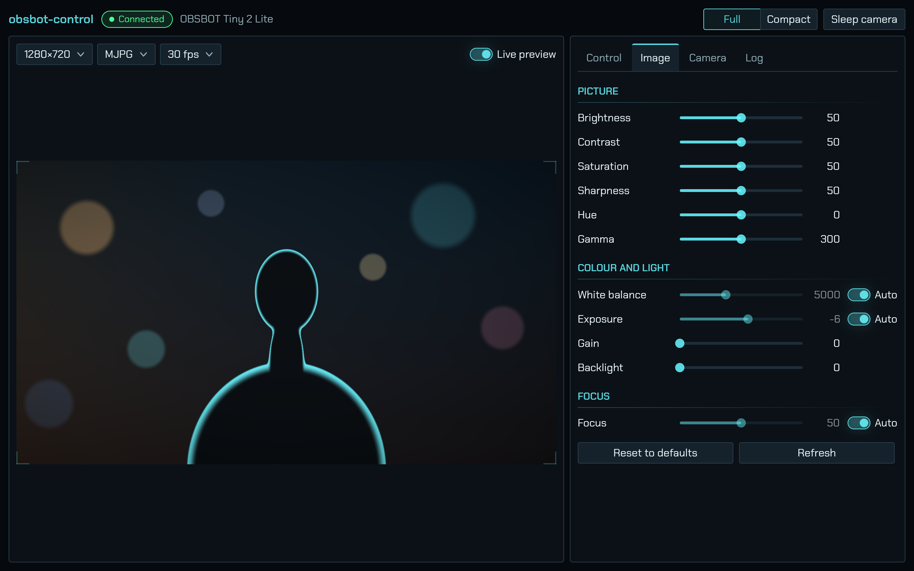

# obsbot-control

> [!IMPORTANT]
> **Unofficial software.** This is an independent community project. It is not made by,
> affiliated with, endorsed by or supported by OBSBOT. Please don't contact OBSBOT support
> about this app; report problems here on GitHub instead. For official software, use
> OBSBOT Center.

A small, unofficial, free and open-source app for **Windows and Linux** that controls an
**OBSBOT Tiny 2 Lite** webcam (and probably the Tiny 2), without the official OBSBOT Center software.



- **One file.** A single `.exe` on Windows, a single `.AppImage` on Linux. No installer and no admin rights.
- **Private.** Works entirely offline: no account, no telemetry, no internet access, no update checks.
  (The interface library includes networking code for other uses; this app never calls it.)
- **Dark mode**, written in New Zealand English.
- **No proprietary code.** It talks to the camera with standard USB video (UVC) controls plus
  the camera's vendor commands, as documented by other open-source projects.
- Written in Rust, with the [GPUI](https://www.gpui.rs/) interface library.

Inspired by [obsbot4linux](https://github.com/vampyren/obsbot4linux).

## Features

| Area | Controls |
|---|---|
| AI tracking | Off, Normal, Upper body, Close-up, Headless, Lower body, Group, Hand, Whiteboard, Desk; Standard/Sport speed |
| Gimbal | Hold-to-move arrows (smooth or stepped, with invert switches), Centre, pan/tilt sliders, 3 one-click presets |
| Zoom | Zoom slider |
| Picture | Brightness, contrast, saturation, sharpness, hue, gamma, white balance, exposure, gain, backlight, focus (with Auto where supported) |
| Camera | HDR, field of view (wide/medium/narrow), anti-flicker (50 Hz default for NZ), sleep/wake |
| Other | Live preview with resolution, pixel format and frame rate pickers (can be turned off), compact view, activity log, *Copy diagnostics*, optional Developer tab for protocol testing, demo mode |

<table>
  <tr>
    <td></td>
    <td></td>
  </tr>
  <tr>
    <td></td>
    <td></td>
  </tr>
</table>

*The screenshots use the built-in demo camera (`--demo`), so the "video" is a drawn scene.*

## Download and run

Get the latest version from [Releases](../../releases). Plug in the camera: the app connects by itself.

### Windows

1. Download `obsbot-control.exe` and run it. Windows SmartScreen may warn because the exe isn't
   code-signed; choose *More info → Run anyway*.
2. Requirements: Windows 10 or 11, 64-bit. Windows "N" editions need the free *Media Feature Pack*.

Settings and the log live in `%APPDATA%\obsbot-control\`. Delete that folder to reset. Settings from the
older `osbot-oss-windows` app are copied across the first time.

### Linux

1. Download `obsbot-control-x86_64.AppImage`.
2. Make it executable and run it:

   ```sh
   chmod +x obsbot-control-x86_64.AppImage
   ./obsbot-control-x86_64.AppImage
   ```

It works on Wayland and X11 desktops, including Fedora, Ubuntu and Arch. It needs a graphics driver with
Vulkan support, which current Intel, AMD and NVIDIA drivers all have.

- If it won't start and mentions FUSE, either install FUSE 3 (`sudo dnf install fuse3` on Fedora,
  `sudo apt install fuse3` on Ubuntu) or run it with `--appimage-extract-and-run`.
- Logged-in users can normally use the camera straight away. If the log says permission was denied for
  `/dev/video…`, add yourself to the `video` group (`sudo usermod -aG video $USER`) and log in again.
- Settings and the log live in `~/.config/obsbot-control/`. Delete that folder to reset.

### Tips

- Only one app can use the camera's **video** at a time. If Teams, Zoom, Discord or another app is
  already using the camera, the app opens in **compact view**: the same controls without the preview,
  in a narrower window. It switches back when the other app lets go of the camera, and the *Full | Compact*
  switch at the top changes it by hand. While you're using another window the preview pauses, so you can
  turn on your camera in a call with this app still open. The controls keep working either way.
- Want to look around first? Run it with `--demo` to use a simulated camera.

## Status

Version 1.0 is a complete rewrite in Rust that adds Linux support. The Windows camera code is a careful port of
version 0.3, which was tested on a real Tiny 2 Lite (AI tracking, gimbal, presets, HDR, field of view, sleep
and the preview pickers all worked). The Linux version hasn't been tested on a real camera yet, and the
Tiny 2 hasn't been tested at all. If something doesn't work on your camera, see
[docs/TESTING.md](docs/TESTING.md) and [docs/PROTOCOL.md](docs/PROTOCOL.md), and use *Log → Copy diagnostics*
when reporting it.

## Building from source

Install [Rust](https://rustup.rs/) (1.89 or later; `rust-toolchain.toml` picks the tested version), then the system libraries:

- **Fedora:** `sudo dnf install gcc clang pkgconf-pkg-config libxkbcommon-devel libxkbcommon-x11-devel wayland-devel vulkan-loader-devel libxcb-devel freetype-devel fontconfig-devel`
- **Ubuntu/Debian:** `sudo apt install build-essential clang pkg-config libxkbcommon-dev libxkbcommon-x11-dev libwayland-dev libvulkan-dev libx11-xcb-dev libxcb1-dev libfreetype-dev libfontconfig-dev`
- **Windows:** Visual Studio 2022 or later (or the Build Tools) with the *Desktop development with C++* workload.

```sh
cargo build --release
./target/release/obsbot-control            # or target\release\obsbot-control.exe
./target/release/obsbot-control --demo     # with the simulated camera
cargo test                                 # protocol, safety and interface-logic tests
packaging/linux/build-appimage.sh          # Linux: makes dist/obsbot-control-x86_64.AppImage
```

The OBSBOT SDK is **not** needed and is **not** part of this repository.

## Disclaimer

- "OBSBOT" and "Tiny" are trademarks of their respective owner. They're used here only to
  say which camera this app works with.
- This app is provided as is, with no warranty (see the MIT licence). Use it at your own risk.
- It only changes camera settings. It never updates or modifies the camera's firmware.
  If the camera ends up in an odd state, unplug it and plug it back in, or reset it in
  OBSBOT Center.

## Licence

[MIT](LICENSE). Third-party components and credits: [THIRD_PARTY_NOTICES.md](THIRD_PARTY_NOTICES.md).
